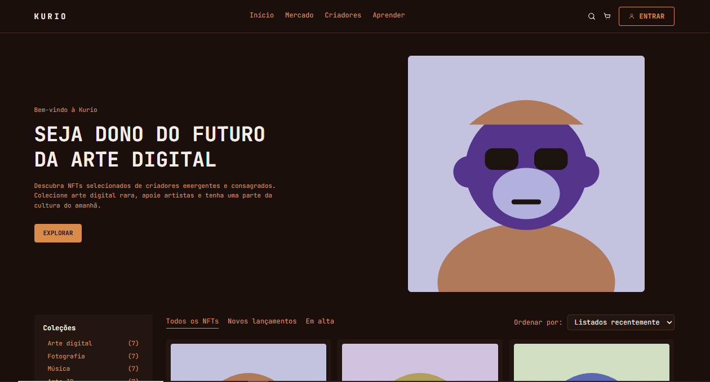
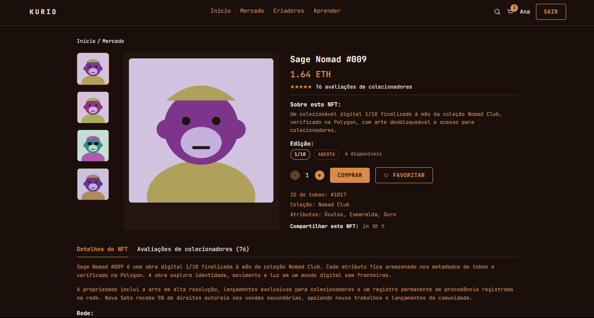
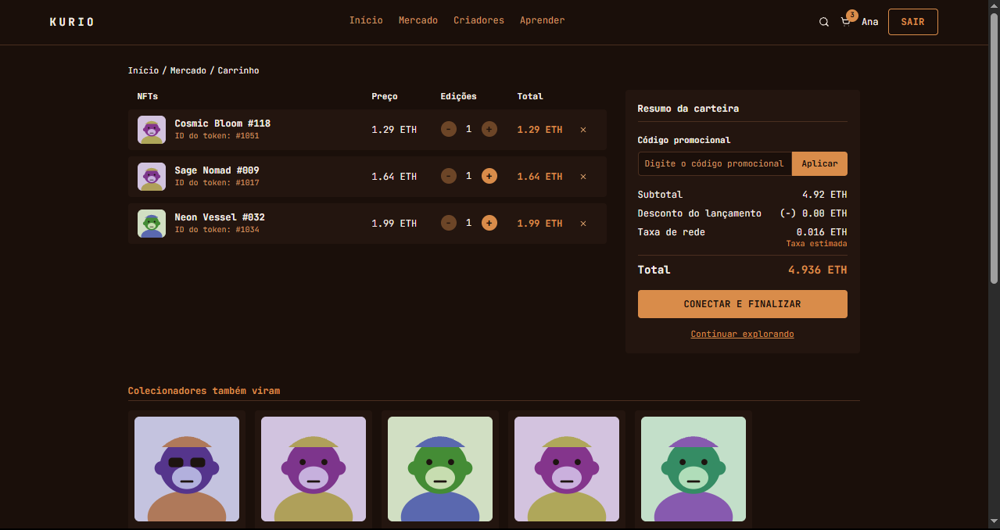
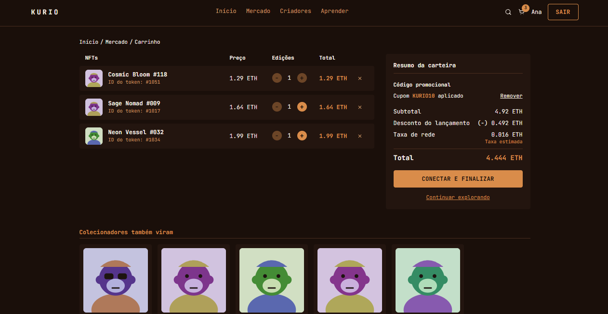
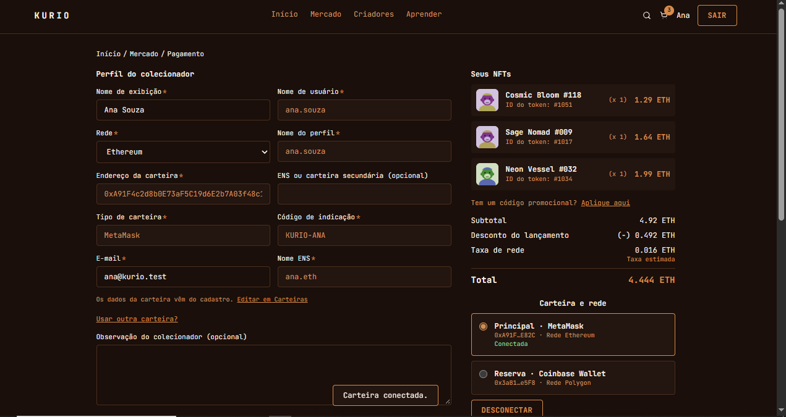
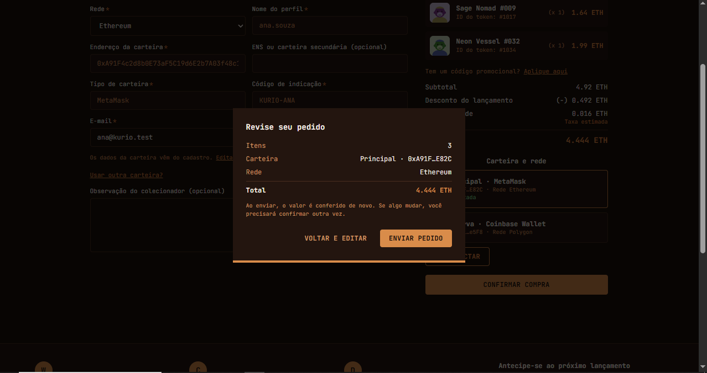
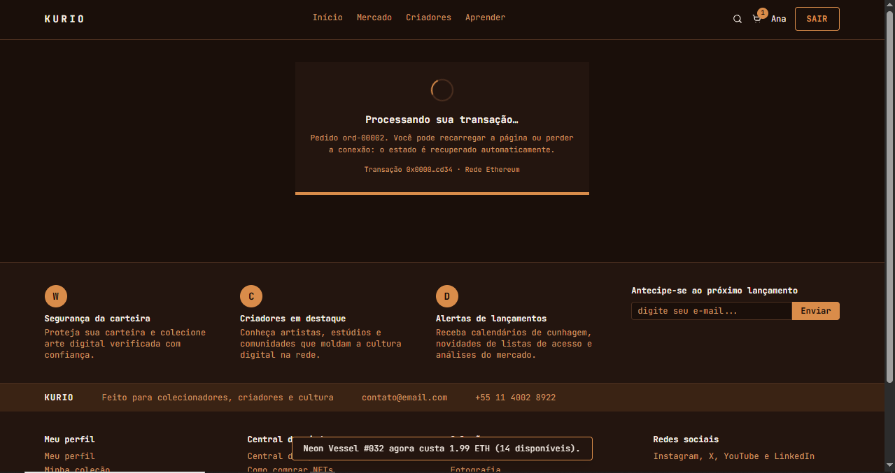
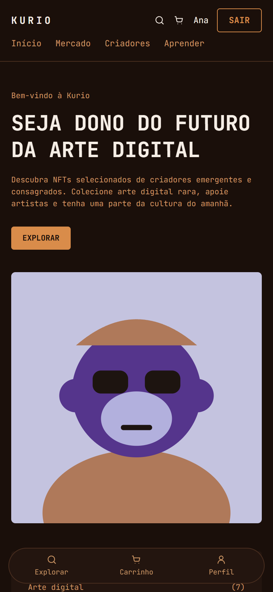

# Kurio — Marketplace de NFTs


Aplicação front-end de um marketplace de NFTs, desenvolvida como desafio técnico a partir de um layout no Figma. Cobre o fluxo completo de compra, com catálogo, detalhe, carrinho, pagamento e confirmação, além de login, cadastro, perfil e carteiras, em desktop e mobile.

🔗 **[Ver aplicação online](https://frontend-challenge-kappa-lac.vercel.app)**

## Telas

### Catálogo e detalhe

| Início | Detalhe do NFT |
|---|---|
|  |  |

### Carrinho

| Carrinho | Carrinho com cupom aplicado |
|---|---|
|  |  |

### Checkout

| Pagamento | Revisão do pedido |
|---|---|
|  |  |

| Pedido pendente | Confirmação |
|---|---|
|  |  |

### Mobile



## Destaques

- **Fluxo completo de compra:** início, detalhe, carrinho, pagamento, confirmação, login, cadastro, perfil e carteiras, em desktop e mobile.
- **72 testes E2E com Playwright**, rodando em desktop, mobile e tablet, incluindo regressão visual.
- **Tempo real com Socket.IO:** descarta eventos duplicados e antigos, e reconcilia os dados ao reconectar.
- **Checkout idempotente:** o pedido usa `Idempotency-Key`, então clique repetido, timeout ou refresh não geram compra duplicada.
- **Estado remoto com TanStack Query:** cache, retries apenas para falhas transitórias, atualização otimista com rollback e filtros do catálogo guardados na URL.
- **Performance medida:** Lighthouse com mediana de 3 medições. Desktop com nota 100 em Performance; mobile entre 82 e 88, abaixo da meta de 90, com as causas documentadas. No detalhe do NFT, o CLS no desktop caiu de 0,46 para 0.
- **Ambiente simulado controlável:** camada MSW (REST + Socket.IO) com cenários de falha (latência, erro 503, sessão expirada, preço alterado no checkout etc.).

## Stack

| Área | Tecnologias |
|---|---|
| Interface | React, TypeScript, Tailwind CSS, shadcn/ui |
| Rotas e dados | TanStack Router, TanStack Query, Axios |
| Tempo real | Socket.IO |
| Mocks | MSW (REST e WebSocket) |
| Qualidade | Playwright (E2E e regressão visual), Lighthouse, typecheck e lint |
| Deploy | Vercel |


## O que eu implementei

O desafio forneceu o enunciado e o layout no Figma. Todo o restante foi desenvolvido por mim:

- **Interface:** todas as telas (início, detalhe, carrinho, pagamento, confirmação, login, cadastro, perfil e carteiras), em desktop e mobile, a partir do Figma
- **Estado remoto:** TanStack Query com cache, retries para falhas transitórias, atualização otimista com rollback e filtros do catálogo guardados na URL
- **Carrinho e checkout:** carrinho de visitante e autenticado com mesclagem no login, cotação como fonte da verdade e pedido idempotente
- **Tempo real:** cliente Socket.IO com descarte de duplicatas e eventos antigos, e reconciliação ao reconectar
- **Camada de mocks:** MSW para REST e WebSocket, com cenários de falha controláveis
- **Qualidade:** 72 testes E2E com Playwright (incluindo regressão visual) e auditoria Lighthouse reproduzível

## Decisões técnicas

Resumo das principais decisões. O detalhamento completo está em [`ARCHITECTURE.md`](./ARCHITECTURE.md).

- **Camadas:** UI → hooks de feature → Axios → MSW. Os mocks existem só na camada de rede, então componentes e hooks não têm caminhos alternativos para dados fictícios.
- **Sessão:** em caso de `401 session_expired`, a sessão é encerrada, o cache é limpo, o socket é fechado e o usuário volta ao login. Depois do login, retorna para a rota em que estava.
- **Carrinho:** visitante usa `localStorage`; usuário autenticado usa a API como fonte da verdade, com atualização otimista. Preço, desconto, taxa e total vêm sempre da cotação da API, e as contas em ETH usam `BigInt` (18 casas) para evitar erro de ponto flutuante.
- **Pedidos:** a chave de idempotência é derivada da intenção de compra. Valores que mudam com preço e estoque ficam de fora de propósito, para que uma nova tentativa recupere o mesmo pedido em vez de criar outro.
- **Cache e retries:** leituras repetem até 2 vezes com backoff, só para rede, 5xx e 429. Mutations não repetem sozinhas.
- **Tempo real:** eventos têm `eventId` e `version`; duplicatas e versões antigas são ignoradas, e a reconexão invalida o cache ativo.
- **Performance:** esqueleto do detalhe com as mesmas dimensões do conteúdo final (elimina o deslocamento de layout), code splitting das rotas menos acessadas e imagens com `width` e `height`.

## Qualidade

- `npm run typecheck` e `npm run lint`
- `npm run test:e2e` — 72 testes Playwright
- `npm run lighthouse` — notas, LCP, CLS e TBT em `lighthouse/SUMMARY.md`

### Lighthouse

Mediana de 3 medições por página e perfil, com build otimizado e mocks ativos (01/11/2026). Metas do desafio: Performance ≥ 90, Accessibility ≥ 95, Best Practices ≥ 95 e SEO ≥ 90.

| Página | Perfil | Performance | Accessibility | Best Practices | SEO | LCP | CLS | TBT |
|---|---|---:|---:|---:|---:|---:|---:|---:|
| Início | Desktop | **100** | 97 | 96 | 92 | 671 ms | 0,01 | 16 ms |
| Detalhe | Desktop | **100** | 97 | 96 | 92 | 686 ms | 0 | 12 ms |
| Início | Mobile | 88 | 97 | 96 | 92 | 773 ms | 0 | 485 ms |
| Detalhe | Mobile | 82 | 97 | 96 | 92 | 3126 ms | 0 | 469 ms |

No mobile, a Performance ficou abaixo da meta (88 e 82). A simulação usa 4G lenta e CPU 4x mais lenta, e o pacote inicial carrega a camada de mocks, que o enunciado exige no build publicado. As causas e os próximos cortes estão em [`ARCHITECTURE.md`](./ARCHITECTURE.md), na seção "Performance e Lighthouse". Relatórios completos em `lighthouse/reports/`.

Os resultados abaixo da meta no mobile e as causas estão explicados em [`ARCHITECTURE.md`](./ARCHITECTURE.md), na seção "Performance e Lighthouse".

---

# Documentação técnica

## Setup

```bash
npm install
npm run dev          # desenvolvimento, com mocks ligados
npm run typecheck
npm run lint
npm run build && npm run preview
npm run smoke        # valida REST + Socket.IO da camada de mocks fora do navegador
npm run test:e2e     # Playwright (sobe build + preview sozinho)
npm run test:e2e:update  # cria/atualiza as baselines da regressão visual
npm run e2e:report   # abre o relatório HTML
npm run lighthouse   # auditoria Lighthouse (início e detalhe, mobile e desktop, mediana de 3)
```

Variável de ambiente: `VITE_ENABLE_MOCKS` (padrão ligada; `false` desliga o MSW).

## Credenciais fictícias

| Usuário | E-mail | Senha | Carteiras |
| --- | --- | --- | --- |
| Ana | ana@kurio.test | Kurio@123 | principal (MetaMask) e secundária (Coinbase Wallet, **sempre recusa conexão**) |
| Bruno | bruno@kurio.test | Kurio@123 | nenhuma |

Cupons: `KURIO10` (10%), `LANCAMENTO5` (5%), `EXPIRADO` (expirado). Qualquer outro é inválido.

## Cenários de mock

Escolha por `?scenario=<nome>` na URL (fica salvo no navegador) ou `POST /__mock/scenario {"name": "..."}`.
`POST /__mock/reset` restaura o cenário conhecido (dados, sessões e cenário).

| Cenário | Efeito |
| --- | --- |
| `default` | sucesso, latência baixa |
| `empty` | catálogo sem resultados |
| `slow` | 2,5 s em toda resposta |
| `variable_latency` | latência variável e determinística |
| `out_of_order` | a 1ª busca do catálogo responde por último |
| `offline` | falha de conexão em tudo |
| `server_error` | HTTP 503 em `GET /api/nfts` |
| `flaky` | a 1ª chamada de cada busca falha; a repetição funciona |
| `session_expired` | a próxima chamada autenticada devolve 401 `session_expired` |
| `favorites_fail` | mutations de favoritos falham (503) |
| `price_changed_at_checkout` | o preço muda ao criar o pedido (409 `price_changed`) |
| `sold_out_at_checkout` | a edição esgota ao criar o pedido (409 `sold_out`) |
| `order_timeout` | o pedido é criado, mas a resposta se perde; repetir com a mesma `Idempotency-Key` recupera o mesmo pedido |
| `payment_declined` | o pedido termina como recusado |

## Controle do ambiente simulado (demo e testes)

Chamados pelo `fetch` da própria página (o MSW intercepta no navegador):

- `POST /__mock/nfts/:id` `{price?, editionsAvailable?}` altera o NFT e emite `nft.updated` pelo Socket.IO
- `POST /__mock/socket/emit` `{event, payload}` entrega um evento como recebido (duplicata, versão antiga, outro usuário)
- `POST /__mock/socket/disconnect` derruba as conexões (reconexão e reconciliação)
- `POST /__mock/orders/:id/settle` resolve um pedido pendente na hora

## Deploy

`vercel.json` já reescreve rotas para `index.html` (refresh e acesso direto) e preserva `mockServiceWorker.js`.

## Testes E2E (Playwright)

```bash
npx playwright install chromium     # uma vez
npm run test:e2e:update             # 1ª vez: gera as baselines visuais (e2e/visual.spec.ts-snapshots/)
npm run test:e2e
npm run e2e:report                  # relatório HTML; traces das falhas ficam em test-results/
```

- Roda contra o build otimizado com o MSW ativo. Cada teste abre um contexto novo: o "banco" simulado vive no `localStorage` do contexto, então todo teste começa de um estado conhecido.
- Projetos: `desktop` (1440×900, todos os testes), `mobile` (390×844: compra, autenticação, carrinho e responsividade) e `tablet` (768×1024: responsividade).
- REST passa pelos handlers MSW; tempo real passa pelo `socket.io-client` real (eventos disparados por `/__mock/...`, nunca por setters na UI).
- Latência e falhas são controladas pelos cenários (`?scenario=...`), então os testes sensíveis a tempo não dependem de relógio real.

> **Regressão visual:** as capturas de referência dependem do sistema operacional (o Playwright acrescenta `-win32`, `-linux` ou `-darwin` ao nome). Gere as do seu ambiente com `npm run test:e2e:update` antes de rodar `npm run test:e2e`. Se a máquina for lenta, use `-- --workers=2`.

## Lighthouse

```bash
npm run lighthouse
```

Usa o Chrome instalado na máquina (ou `CHROME_PATH`). Ao terminar, veja `lighthouse/SUMMARY.md` (notas, LCP, CLS, TBT, versões das ferramentas e condições da execução) e abra os relatórios em `lighthouse/reports/*.html`. Resultados abaixo da meta e as causas estão em `ARCHITECTURE.md` (seção "Performance e Lighthouse").
